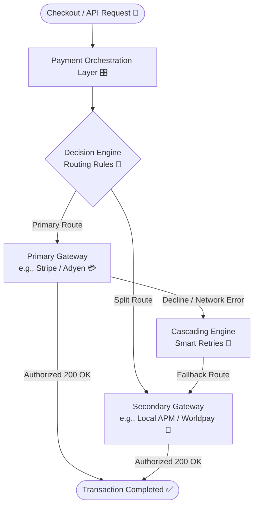

  

# ⚡ Awesome Smart Payment Routing & Cascading

  
  
  
  
  

> 💳 A curated collection of top **Smart Payment Routing (SPR)**, **Payment Cascading**, and **Payment Orchestration Platforms (POP)** — featuring hosted SaaS leaders and production-grade open-source solutions to dynamically route transactions across multiple payment service providers (PSPs), maximize card authorization rates, minimize payment processing interchange fees, and eliminate single points of failure. 🚀

---

## 📋 Table of Contents

- [🌐 Sector Overview & Market Dynamics](#-sector-overview--market-dynamics)
- [🟦 SaaS / Hosted Platforms](#-saas--hosted-platforms)
- [🟩 Open-Source Software](#-open-source-software)
- [⚙️ Key Architectural Concepts](#️-key-architectural-concepts)
- [📊 Comparison at a Glance](#-comparison-at-a-glance)
- [📈 Star History](#-star-history)
- [💖 Support & Sponsorship](#-support--sponsorship)
- [🤝 Contributing](#-contributing)
- [📄 License](#-license)

---

## 🌐 Sector Overview & Market Dynamics

The global payment orchestration platform (POP) and smart payment routing market is estimated at **$1.7B to $2.6B in 2024–2025**, projected to grow at a **18%–24% CAGR** toward **$7B+ by 2030** driven by surging global cross-border e-commerce 🌍, multi-acquirer redundancy strategies 🛡️, and alternative payment method (APM) proliferation 📱.

The sector is **moderately fragmented** among independent pure-play orchestration and routing platforms (e.g., Spreedly, IXOPAY, Gr4vy, Hyperswitch) catering to merchants demanding gateway-agnostic token ownership and route flexibility, yet operates within a **concentrated broader payments landscape** dominated by mega-acquirers and enterprise PSPs (e.g., Adyen, Worldpay, Checkout.com) who leverage proprietary transaction volume datasets and machine-learning models to power native intelligent routing and dynamic acceptance suites. 📊

---

## 🟦 SaaS / Hosted Platforms

Enterprise cloud-hosted smart payment routing and payment orchestration engines. Sorted by company scale (valuation / annual revenue descending). 🏢

| Platform | Company Valuation / Revenue | Starting Tier Pricing | Free Tier / Trial Limit | Key Routing Capabilities | Best For |
|:---|:---|:---|:---|:---|:---|
| **[Adyen](https://www.adyen.com)** | **~$43B – $45B** Market Cap / **€2.36B (~$2.5B)** Annual Net Revenue | **$0.13 fixed processing fee** + interchange++ per transaction attempt | **Free Sandbox environment** with test API credentials & simulated issuer responses (no production free tier) | Machine-learning route optimization via Optimize suite, dynamic CVV/AVS payload adjustment, AI-driven auto-retries, auto-rescue for recurring dunning, and network token routing 🤖 | High-volume global enterprises seeking fully managed AI-driven acquiring route optimization 🌐 |
| **[Worldpay](https://www.worldpay.com)** | **$24.25B** Valuation (Acquired by Global Payments) / **~$5.0B** Annual Revenue | **Interchange++ or custom blended rate** (varies by volume; typical entry at **~1.5% + $0.20** per card transaction) | **Free Developer Sandbox** and complimentary pre-onboarding historical transaction cost-benefit audit (no production free tier) | Dynamic real-time debit routing, least-cost routing across PIN debit networks, automatic failover rerouting during mid-transaction acquirer outages, and cross-border domestic route mapping ⚡ | Enterprise retailers and omni-channel merchants seeking least-cost debit routing and high-availability failover 🏬 |
| **[Checkout.com](https://www.checkout.com)** | **$12.0B** Valuation / **~$488M** Annual Revenue | **Interchange++** pricing (custom negotiated markup based on volume; free processing for registered charities) | **Free Developer Sandbox** with complete dashboard access, simulated decline codes, and webhook testing (no production free tier) | Intelligent Acceptance sub-150ms ML micro-decisions across 5 families: dynamic payload formatting, 3DS smart exemption routing, adaptive token choice (DPAN vs. FPAN), and context-aware retries 🧠 | Mid-market to enterprise merchants wanting hands-off AI optimization across routing, 3DS exemptions, and retries 🎯 |
| **[Chargebee](https://www.chargebee.com)** | **$3.5B** Valuation / **~$202M** Annual Revenue | **Starter Plan: $0/month** base fee + 0.75% overage on cumulative billing over $250k; **Performance Plan: $599/month** (billed annually) | **Starter Plan: Free forever up to $250,000 cumulative lifetime billing**; also features a **14-day free trial** for higher tiers | Dynamic Smart Routing continual review split logic between Chargebee Pay and one secondary external gateway for USD card transactions 🔄 | Subscription-first businesses needing integrated billing with percentage split routing across secondary gateways 🔄 |
| **[Spreedly](https://www.spreedly.com)** | **~$500M** Valuation / **~$25M** Annual Revenue | **Independent Vault Plan starting at $750/month** base platform fee + volume-tiered API call pricing | **30-day free trial** evaluation account with developer test API limits and sandbox environment | Gateway-agnostic routing across 120+ connected PSPs/gateways, universal independent card vault, network tokenization, and multi-gateway fallback cascades 🔒 | Merchants demanding vendor lock-in prevention, token portability, and orchestration across heterogeneous gateways 🛡️ |
| **[IXOPAY](https://www.ixopay.com)** | **~$150M – $200M** Enterprise Valuation (K1 portfolio) / **~$25M** Annual Revenue | **Custom enterprise platform fee + per-transaction fee** (starting custom quote tier based on monthly volume & connector count) | **Dedicated Sandbox access** and tailored proof-of-concept (PoC) demonstration upon enterprise request | IXO One AI-native smart routing, MCP server connectivity, unified token vault, adapter SDK across 250+ providers, and automated decline-recovery cascading 🧩 | Global omnichannel merchants needing modular orchestration, tokenization, and AI-assisted routing rules 🌍 |
| **[Paydock](https://www.paydock.com)** | **~$130M** Valuation / **~$15M** Annual Revenue | **Custom SaaS platform fee + volume-based tier fee** (custom monthly commitment based on volume) | **Developer Sandbox environment** and customized enterprise walkthrough upon request | Dynamic routing engine across 50+ deep banking/processing partners, PAN/BIN/currency-based rules, SAML SSO, and granular IP whitelist/blacklist security controls 🏦 | Financial institutions, banks, and major retailers requiring modular orchestration and high compliance governance 🏛️ |
| **[Gr4vy](https://www.gr4vy.com)** | **~$115M** Valuation / **~$8M** Annual Revenue | **Custom Infrastructure-as-a-Service monthly subscription** based on dedicated cloud instance + transaction tier | **Guided Developer Sandbox & Interactive Demo** environment upon request (no self-serve free production tier) | Cloud-native single-tenant infrastructure, visual Split Routing for live A/B routing variant testing, dynamic failover logic, native mobile 3DS, and 100+ local payment method connectors ☁️ | Fast-scaling global merchants wanting dedicated private-cloud instances and visual A/B routing experimentation 🚀 |

---

## 🟩 Open-Source Software

Self-hosted, transparent, and community-audited smart payment routing engines, multi-gateway switches, and financial ledgers. Sorted by GitHub stars descending. 💻

### [Juspay Hyperswitch](https://github.com/juspay/hyperswitch) 
* **Stack:** Rust 🦀 | **License:** Apache-2.0 📜  
* **Overview:** Hyperswitch is the premier production-grade open-source payment orchestration switch designed to unify payments across 100+ gateways and payment aggregators through a single API. It handles high-concurrency peak processing (up to 5,000 TPS) with active-active multi-region deployment.
* **Smart Routing & Cascading:**
  * **Intelligent Rule-Based Routing:** Configure complex routing trees evaluated in sub-30ms based on card brand, country, currency, ticket size, and merchant category codes. ⏱️
  * **Volume-Based Split Routing:** Programmatically distribute transactions across PSPs based on pre-set quota splits and negotiated rate tiers. ⚖️
  * **Smart Retries & Cascading:** Automatically cascade declined transactions to secondary and tertiary gateways based on raw ISO-8583 response codes and issuer decline telemetry. 🔄
  * **PCI-Compliant Token Vault:** Independent locker service to secure and tokenize cards, decoupling cardholder data from downstream payment providers. 🔐

### [BTCPay Server](https://github.com/btcpayserver/btcpayserver) 
* **Stack:** C# (.NET Core) 🔷 | **License:** MIT 📜  
* **Overview:** BTCPay Server is an open-source, self-hosted cryptocurrency payment processor engineered for censorship resistance and zero intermediary processing fees.
* **Smart Routing & Cascading:**
  * **Payment Rail Fallback Routing:** Directs incoming cryptocurrency transactions across on-chain Bitcoin, native Lightning Network channels, and Liquid sidechains. ⚡
  * **Liquid & Lightning Auto-Routing:** Intelligently balances liquidity across Lightning payment channels to guarantee payment routing success for micro-invoices. 🌊
  * **Auto-Forwarding & Payout Cascading:** Automatically forwards and sweeps incoming client deposits to multi-signature cold storage or liquid custodial addresses based on threshold rules. 💼

### [Kill Bill](https://github.com/killbill/killbill) 
* **Stack:** Java ☕ | **License:** Apache-2.0 📜  
* **Overview:** Kill Bill is an enterprise-grade open-source subscription billing and payments engine designed to replace proprietary SaaS billing services with full infrastructure sovereignty.
* **Smart Routing & Cascading:**
  * **Plugin-Based Payment Routing:** Routes transactions dynamically to different payment gateway plugins (Stripe, Adyen, Braintree, Cybersource) according to account attributes, currency, and geography. 🔌
  * **Configurable Dunning & Retry Cascading:** Highly configurable state-machine dunning workflows that retry failed recurring payments at customizable intervals and cascade to alternative registered payment methods. 🔁
  * **Payment Control APIs:** Intercepts authorization attempts prior to execution for customized risk checks, route decisions, and fee minimization calculations. 🛡️

### [ActiveMerchant](https://github.com/activemerchant/active_merchant) 
* **Stack:** Ruby 💎 | **License:** MIT 📜  
* **Overview:** Developed originally by Shopify and maintained by an extensive community, ActiveMerchant is the foundational open-source payment gateway abstraction library in Ruby.
* **Smart Routing & Cascading:**
  * **Unified Multi-Gateway Interface:** Standardizes API interactions across 140+ payment gateways through a unified contract (`authorize`, `purchase`, `capture`, `void`, `refund`). 🎛️
  * **Custom Gateway Switching:** Functions as the driver layer for custom application-level payment routing engines to seamlessly redirect transactions to fallback gateways when primary endpoints fail. 🔀
  * **Normalized Decline Codes:** Harmonizes distinct gateway response objects to enable uniform downstream cascading and retry logic. 📑

### [Formance Stack](https://github.com/formancehq/stack) 
* **Stack:** Go 🐹 | **License:** Apache-2.0 📜  
* **Overview:** Formance provides open-source programmable financial architecture and dual-entry ledger microservices to model and track money movements across diverse payment rails.
* **Smart Routing & Cascading:**
  * **Payment Flow Orchestration (Numscript):** Declaratively script complex routing and split-payment paths between card processors, digital wallets, and payout rails. 📜
  * **Connector Framework:** Connects natively to Stripe, Wise, Modulr, Mangopay, and banking APIs, continuously pulling transaction state to trigger multi-step routing sequences. 🔗
  * **Idempotent Ledger Integration:** Ensures zero lost funds or duplicate settlements across asynchronous multi-gateway payment routing pipelines. 💰

### [Juspay Decision Engine](https://github.com/juspay/decision-engine) 
* **Stack:** Rust 🦀 / JavaScript 🟨 | **License:** Apache-2.0 📜  
* **Overview:** A decoupled, low-latency decision control plane extracted from Juspay's payment infrastructure, built specifically for evaluating routing algorithms and transaction rules.
* **Smart Routing & Cascading:**
  * **Sub-Millisecond Policy Evaluation:** Evaluates multi-attribute payment criteria (card BIN, issuer bank health, fees, time of day) with ultra-low latency. ⚡
  * **Dynamic Feedback Loop:** Ingests live telemetry and processor health metrics to immediately steer transactions away from degraded gateways to optimal routes. 🔄

### [Conductor Smart Payment Switch](https://github.com/malwarebo/conductor) 
* **Stack:** Go 🐹 | **License:** MIT 📜  
* **Overview:** An open-source smart payment gateway switch and router supporting integrations across Stripe, Xendit, Airwallex, and Razorpay.
* **Smart Routing & Cascading:**
  * **Multi-Gateway Smart Dispatch:** Automatically evaluates incoming payload currency, transaction amount, and geo-origin to dispatch transactions to the optimal configured provider. 🗺️
  * **Fallback Circuit-Breaker:** Detects provider API downtime and routes consecutive attempts to active backup gateways. 🔌

---

## ⚙️ Key Architectural Concepts

1. **Smart Payment Routing (SPR):** Dynamically selecting the optimal payment provider (PSP, acquiring bank, or processor) for each transaction based on rules (card brand, issuer country, transaction amount, currency, transaction fee) or real-time ML signals (acquirer authorization health, latency). 🎯
2. **Payment Cascading (Failover Routing):** Seamlessly re-routing a declined or timed-out transaction to an alternative gateway in real time without prompting the shopper to re-enter payment details. 🔄
3. **Gateway-Agnostic Tokenization:** Storing sensitive cardholder data (PAN) in an independent Level 1 PCI DSS compliant vault to prevent vendor lock-in and enable routing across any connected payment gateway. 🔐
4. **Least-Cost Routing (LCR):** Steering debit and credit card transactions across the network path (e.g., local PIN debit vs. global card networks) that incurs the lowest interchange and processing fee. 💵
5. **Smart Dunning & Intelligent Retries:** Utilizing issuer-response decline taxonomy (e.g., distinguishing "insufficient funds" from "do not honor") to schedule optimal automatic retry attempts. ⏰

---

## 📊 Comparison at a Glance

| Solution | Deployment | License | Primary Focus | Multi-Gateway Connectors | Smart Routing Type | Dynamic Cascading |
|:---|:---|:---|:---|:---|:---|:---|
| **Adyen** | Cloud SaaS ☁️ | Proprietary 🔒 | Global Acquirer & Orchestration | Native global acquiring network | AI / ML auto-optimization 🤖 | ✅ Auto-retries & rescue |
| **Worldpay** | Cloud SaaS ☁️ | Proprietary 🔒 | Enterprise Acquiring & Routing | Proprietary / Partner network | Real-time adaptive & least-cost ⚡ | ✅ Mid-transaction rerouting |
| **Checkout.com** | Cloud SaaS ☁️ | Proprietary 🔒 | Global Acquirer & Acceptance | Native acquiring network | Sub-150ms ML micro-decisions 🧠 | ✅ Context-aware retries |
| **Chargebee** | Cloud SaaS ☁️ | Proprietary 🔒 | Subscription Billing & Payments | 40+ gateways | Dynamic split ratio 🔄 | ⚠️ Limited secondary split |
| **Spreedly** | Cloud SaaS ☁️ | Proprietary 🔒 | Universal Payment Orchestration | 120+ gateways | Rule-based & gateway abstraction 🔒 | ✅ Multi-gateway fallback |
| **IXOPAY** | Cloud SaaS ☁️ | Proprietary 🔒 | Enterprise Orchestration & Vault | 250+ gateways | AI-native & algorithmic 🧩 | ✅ Automated decline cascades |
| **Paydock** | Cloud SaaS ☁️ | Proprietary 🔒 | Bank & Enterprise Orchestration | 50+ deep banking partners | Dynamic rule-based 🏦 | ✅ Automated gateway failover |
| **Gr4vy** | Cloud (IaaS) ☁️ | Proprietary 🔒 | Cloud-Native Private Orchestration | 100+ gateways | Visual Split A/B testing 🧪 | ✅ Dynamic failover rules |
| **Juspay Hyperswitch** | Self-Hosted 🏠 | Apache-2.0 📜 | High-Scale Open-Source Switch | 100+ connectors | Rule-based, volume split & telemetry 🦀 | ✅ Dynamic ISO code cascade |
| **BTCPay Server** | Self-Hosted 🏠 | MIT 📜 | Crypto Payment Processor | On-chain, Lightning, Liquid | Liquidity & channel balancing ⚡ | ✅ Rail fallback |
| **Kill Bill** | Self-Hosted 🏠 | Apache-2.0 📜 | Open-Source Billing & Payments | 30+ plugin gateways | Plugin-based rule routing ☕ | ✅ Configurable dunning cascade |
| **ActiveMerchant** | Library 📚 | MIT 📜 | Gateway Abstraction Layer | 140+ gateways | Application-controlled switching 💎 | ⚠️ Application-level cascade |
| **Formance Stack** | Self-Hosted 🏠 | Apache-2.0 📜 | Money Movement & Ledgers | Banking & PSP connectors | Numscript programmable flows 🐹 | ✅ Multi-step transactional flow |
| **Juspay Decision Engine**| Self-Hosted 🏠 | Apache-2.0 📜 | Low-Latency Decision Control Plane | Agnostic | Sub-ms attribute & telemetry rules ⚡ | ⚠️ Decision engine only |
| **Conductor** | Self-Hosted 🏠 | MIT 📜 | Lightweight Smart Switch | Stripe, Xendit, Airwallex, Razorpay | Currency, amount, and geo routing 🐹 | ✅ Circuit breaker fallback |

---

## 📈 Star History

---

## 💖 Support & Sponsorship

Thank you so much for exploring and using this curated resource! If this list saved you time, helped you evaluate payment gateways, or inspired your checkout and routing architecture, please consider supporting the project:

- ⭐ **Star this repository** to help others discover it!
- 🍴 **Fork and share** with colleagues and engineering teams building payment systems!
- ☕ **Buy me a coffee** or sponsor ongoing maintenance directly on the [GitHub Sponsors Dashboard](https://github.com/sponsors/ishandutta2007)!

Your support keeps this guide updated with the latest tools, transparent pricing data, and production-tested payment infrastructure patterns. 🙏

---

## 🤝 Contributing

Contributions are warmly welcomed! Please feel free to open a Pull Request or Issue to add new open-source payment routers, provide pricing updates, or refine architectural descriptions. 💡

### Submission Guidelines:
- Project name, repository URL, and clear documentation. 🔗
- License (must be OSI-approved for open-source entries). 📜
- Concise explanation of smart payment routing, cascading, or gateway abstraction capabilities. ✍️

---

## 📄 License

This repository and curated list are released under the [Creative Commons Zero v1.0 Universal](LICENSE) (CC0 1.0) Public Domain dedication. Software and services referenced retain their respective copyrights, licenses, and trademarks. ⚖️

---

  ⭐ <b>Star this repository if you find it helpful for your payment architecture!</b> ⭐

